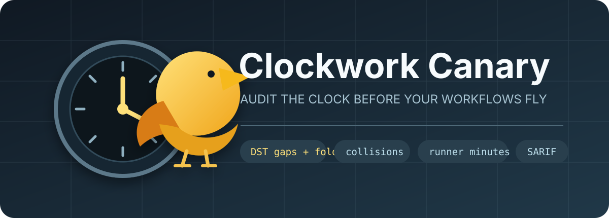

<p align="center">
  
</p>

# Clockwork Canary

[](https://github.com/KanadeK/clockwork-canary/actions/workflows/ci.yml)
[](https://github.com/KanadeK/clockwork-canary/actions/workflows/codeql.yml)
[](https://github.com/KanadeK/clockwork-canary/releases/latest)
[](https://www.python.org/)
[](LICENSE)

**See when every scheduled GitHub Action really runs—before DST, load spikes, collisions, or runner minutes surprise you.**

[简体中文](README.zh-CN.md) · [Research](docs/RESEARCH.md) · [Rules](docs/RULES.md) · [Acceptance](docs/ACCEPTANCE.md) · [Repair guide](docs/REPAIR.md)

GitHub Actions added per-schedule IANA timezones in March 2026. Syntax linters can tell you whether a cron string and timezone are valid. Clockwork Canary answers the operational questions that remain:

- Which UTC and local instants will run over the next year?
- Does a local time disappear in spring or repeat in autumn?
- Do independent workflows land on the same minute?
- Does minute `0` hit GitHub's documented high-load window?
- How many raw runner-minutes could this schedule consume in 30 days?

It scans the repository you already have. No GitHub token, account, telemetry, hosted service, or AI model is required.

## Quick start

```bash
python -m pip install .
clockwork-canary scan . --start 2026-01-01T00:00:00Z
```

Install the released CLI from GitHub:

```bash
pipx install "git+https://github.com/KanadeK/clockwork-canary.git@v0.1.0"
clockwork-canary scan /path/to/repository
```

Inspect one expression without a repository:

```bash
clockwork-canary explain "30 2 * * *" \
  --timezone America/New_York \
  --start 2026-03-07T00:00:00Z \
  --count 4
```

The spring-forward result keeps both facts: the intended `02:30` wall time and the actual advanced run at the next valid local time.

## What it finds

| Rule | What is detected | Default severity |
|---|---|---:|
| `CC001` | Invalid YAML, schedule shape, cron, or IANA timezone | Error |
| `CC002` | An interval shorter than GitHub's five-minute minimum | Error |
| `CC003` | Runs at minute zero, GitHub's documented high-load window | Warning |
| `CC004` | A local run inside a spring-forward gap | Warning |
| `CC005` | A local run inside a repeated fall-back hour | Warning |
| `CC006` | Exact or near collisions across scheduled workflows | Notice/Warning |
| `CC007` | Duplicate cron + timezone entries | Warning |
| `CC008` | Estimated raw runner-minutes above repository policy | Warning |
| `CC009` | A schedule that relies on implicit UTC | Notice |

Every result has a file, line, rule ID, repair text, schedule identifiers, and structured evidence. See [the rule catalog](docs/RULES.md) for exact semantics and non-goals.

## Reports for people and CI

```bash
# Terminal summary; fail on warnings and errors.
clockwork-canary scan . --fail-on warning

# Reviewable pull-request artifact.
clockwork-canary scan . --format markdown --output reports/schedules.md

# Stable machine-readable schema.
clockwork-canary scan . --format json --output reports/schedules.json

# GitHub code-scanning upload.
clockwork-canary scan . --format sarif --output reports/schedules.sarif
```

Use a fixed `--start` in release evidence and golden tests. Without it, simulation starts at the current UTC instant.

## GitHub Action

```yaml
name: Schedule audit

on:
  pull_request:
  push:
    branches: [main]

permissions:
  contents: read

jobs:
  clockwork-canary:
    runs-on: ubuntu-latest
    steps:
      - uses: actions/checkout@v7
      - uses: KanadeK/clockwork-canary@v0.1.0
        with:
          path: .
          fail-on: warning
          format: markdown
          output: clockwork-canary-report.md
```

The composite Action passes inputs through environment variables instead of interpolating them into shell source.

## Repository policy

Generate a documented template:

```bash
clockwork-canary init .
```

Example `.clockwork-canary.json`:

```json
{
  "collision_horizon_days": 14,
  "collision_window_minutes": 5,
  "default_job_minutes": 10,
  "durations": {
    ".github/workflows/nightly.yml": 25
  },
  "fail_on": "warning",
  "horizon_days": 370,
  "ignore": [
    {
      "expires": "2026-12-31",
      "path": ".github/workflows/vendor-sync.yml",
      "reason": "The upstream window is fixed and the job is idempotent.",
      "rule": "CC003"
    }
  ],
  "monthly_minutes_warning": 2000
}
```

Suppressions require a reason and can expire. Unknown configuration keys fail closed, so a typo cannot silently weaken the gate. More-specific duration globs win.

## Reproducible examples

```bash
# Expected exit 0 and zero findings.
clockwork-canary scan examples/healthy-repo \
  --start 2026-01-01T00:00:00Z

# Expected exit 1 with DST, collision, load, frequency, and budget findings.
clockwork-canary scan examples/risky-repo \
  --start 2026-01-01T00:00:00Z
```

Committed sample outputs live in [`docs/generated`](docs/generated). They are regenerated by the release gate, not hand-written screenshots.

## Clockwork Canary vs. actionlint

Use both. [`actionlint`](https://github.com/rhysd/actionlint) is the broad static checker for GitHub Actions syntax, expressions, permissions, action inputs, and cron validity. Clockwork Canary is deliberately narrow and temporal: it expands valid schedules into future instants, models GitHub's documented spring-forward behavior, flags undocumented fall-back ambiguity, correlates schedules across files, and estimates a reviewable runner-minute envelope.

## Honest boundaries

- This is a preflight simulator, not a runtime monitor. It cannot prove GitHub actually started a queued job.
- GitHub documents spring-forward behavior but does not provide a portable fall-back once-versus-twice guarantee. Clockwork Canary flags the ambiguity instead of inventing one.
- Runner-minute estimates are raw planning estimates. Matrix expansion, retries, job conditions, hosted-runner billing multipliers, and actual duration are not inferred.
- GitHub may disable scheduled workflows in inactive public repositories after 60 days. That requires remote activity data and is not claimed by the offline scan.

## Development and release gate

```bash
python -m pip install -e ".[dev]"
python scripts/verify.py
```

The gate runs formatting, lint, strict typing, tests with branch coverage, example acceptance, local-link checks, secret scanning, wheel/sdist construction, clean-environment wheel installation, and release-manifest verification. If anything fails, follow [`docs/REPAIR.md`](docs/REPAIR.md); do not bypass the failing stage.

Architecture and trust boundaries are documented in [`docs/ARCHITECTURE.md`](docs/ARCHITECTURE.md). Contributions are welcome under [`CONTRIBUTING.md`](CONTRIBUTING.md).
