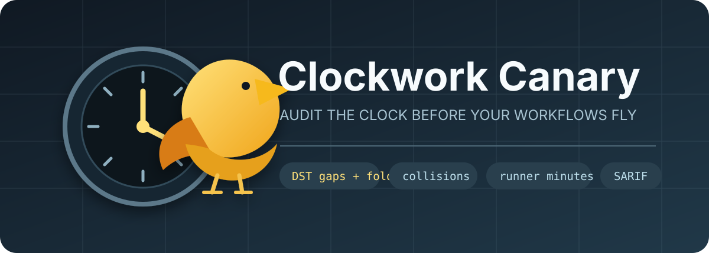

<p align="center">
  
</p>

# Clockwork Canary

**在 DST、整点拥堵、工作流碰撞或 runner 分钟数带来意外之前，先看清每个 GitHub Actions 定时任务究竟何时运行。**

[English](README.md) · [调研依据](docs/RESEARCH.md) · [规则目录](docs/RULES.md) · [验收命令](docs/ACCEPTANCE.md) · [失败修复](docs/REPAIR.md)

GitHub Actions 在 2026 年 3 月加入了每条 cron 独立的 IANA 时区。通用语法检查器能告诉你 cron 和时区是否合法，但不会完整回答这些仓库级问题：

- 未来一年换算成 UTC 和本地时间后，任务具体何时运行？
- 春季跳时会让哪个本地时间消失，秋季回拨会让哪个时间重复？
- 不同工作流是否会在同一分钟争抢资源或撞上同一外部服务？
- 是否集中在 GitHub 官方明确提示的整点高负载窗口？
- 按当前频率、job 数和估计时长，30 天大约消耗多少原始 runner 分钟？

Clockwork Canary 在本地扫描现有仓库，不需要 GitHub Token、账号、遥测、云服务或 AI API。

## 快速开始

```bash
python -m pip install .
clockwork-canary scan . --start 2026-01-01T00:00:00Z
```

从 GitHub Release 对应标签安装：

```bash
pipx install "git+https://github.com/KanadeK/clockwork-canary.git@v0.1.0"
clockwork-canary scan /path/to/repository
```

单独解释一条 cron：

```bash
clockwork-canary explain "30 2 * * *" \
  --timezone America/New_York \
  --start 2026-03-07T00:00:00Z \
  --count 4
```

春季跳时输出会同时保留“原定本地时间 02:30”和“推进到下一个合法时间后的实际运行时刻”，不会丢失因果证据。

## 核心能力

- 扫描 `.github/workflows/**/*.yml` 与 `*.yaml`，正确处理 PyYAML 容易把 `on` 误判为布尔值的陷阱。
- 支持标准五字段 cron 的列表、范围、步长、英文月份和星期名称，以及 POSIX 的日/月匹配语义。
- 基于 IANA 时区模拟未来日历，记录 spring-forward gap 和 fall-back fold。
- 对所有工作流做重复与近距离碰撞分析，而非逐文件孤立检查。
- 输出终端文本、Markdown、JSON 和 SARIF 2.1.0。
- 使用可过期、必须写理由的忽略规则；未知配置字段直接报错。
- 作为 Python CLI 或复合 GitHub Action 运行。

## 可复现验收

```bash
# 预期：退出码 0、零发现。
clockwork-canary scan examples/healthy-repo \
  --start 2026-01-01T00:00:00Z

# 预期：退出码 1，包含 DST、碰撞、整点、频率和预算发现。
clockwork-canary scan examples/risky-repo \
  --start 2026-01-01T00:00:00Z

# 完整发布门禁。
python scripts/verify.py
```

每条命令的前置条件、预期结果与失败定位见 [`docs/ACCEPTANCE.md`](docs/ACCEPTANCE.md)；修复顺序见 [`docs/REPAIR.md`](docs/REPAIR.md)。

## 与 actionlint 的边界

两者应一起用。[`actionlint`](https://github.com/rhysd/actionlint) 是覆盖 GitHub Actions 语法、表达式、权限、Action 输入和 cron 合法性的通用静态检查器。Clockwork Canary 则专注“时间展开后的运营风险”：真实未来时刻、DST、跨文件碰撞、整点负载和 runner 分钟预算。因此它不是重复实现 actionlint。

## 明确限制

- 本项目是发布前模拟器，不是在线监控器，不能证明 GitHub 队列实际按时启动。
- GitHub 已明确 spring-forward 的推进规则，但没有给出跨环境通用的 fall-back 一次/两次保证；本工具会报告歧义，不会猜测。
- runner 分钟是计划估算，不推断 matrix 展开、重试、条件分支、计费倍率和真实时长。
- 公共仓库连续 60 天无活动可能自动停用定时工作流；离线扫描没有远端活动数据，因此不声称检测该状态。

完整英文 README 包含 GitHub Action、配置示例和开发说明。
