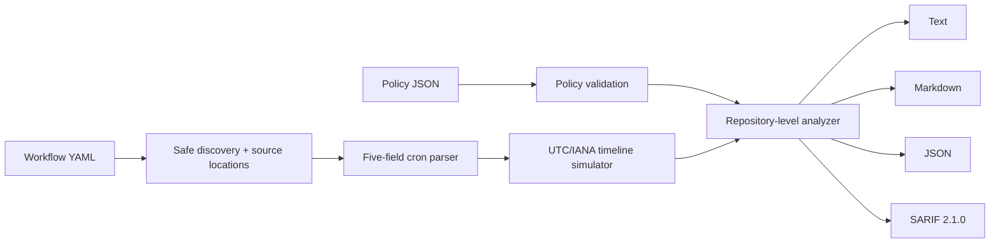

# Architecture

Clockwork Canary keeps discovery, time semantics, policy, and presentation separate so a reporter cannot change an audit decision.

## Modules

- `discovery.py` loads only `.github/workflows/**/*.yml|yaml` with a `SafeLoader` derivative. YAML 1.1's broad boolean resolver is removed so GitHub's `on` key remains a string. A parallel node tree retains the cron scalar line.
- `cron.py` parses exactly five fields, including lists, ranges, steps, month/day names, Sunday `0`/`7`, and POSIX day-of-month/day-of-week OR semantics.
- `cron.py::iter_occurrences` walks real UTC minutes and converts them through `zoneinfo`. It detects a forward jump in wall time and emits advanced occurrences with their intended missing local minute. A repeated hour naturally produces separate UTC instants with `fold=0` and `fold=1`.
- `config.py` validates every key and type. Unknown keys are errors. Suppressions carry path, rule, reason, and optional expiry.
- `analyzer.py` builds per-expression timelines once, derives schedule metrics, applies local rules, then correlates duplicate and near-collision pairs across files.
- `reporters.py` renders one neutral `AuditReport` into human and machine formats.
- `cli.py` owns argument validation, explicit file writes, and severity exit codes.

## Determinism

Use `--start` for deterministic evidence. Given identical source files, policy, package version, tzdata, and start instant:

- schedules and findings are sorted;
- JSON keys are sorted;
- report newlines are LF;
- examples are capped and ordered;
- release manifests sort filenames and use SHA-256.

Timezone rule databases can change when governments change clocks. That is a real input, which is why Windows installs the versioned `tzdata` dependency and reports preserve actual UTC/local examples.

## Complexity controls

The simulator scans minute instants through the policy horizon but retains only eight next runs, three anomaly examples, aggregate counts, and the collision-horizon occurrences. Duplicate cron/timezone pairs share one computed timeline. Collision output is one finding per schedule pair rather than one per event.

## Trust boundaries

- Workflow steps are data and are never executed.
- YAML object construction is restricted to safe scalar/collection types.
- No network client exists in the runtime package.
- Composite Action inputs enter Bash through environment variables and quoted arrays.
- Reports do not emit active HTML.
- The CLI writes only an explicit report path or the policy file requested by `init`.
